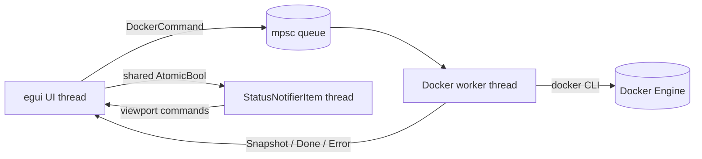

# Architecture

Docker Deck is a single-process Linux desktop application. The UI, the Docker
worker, and the StatusNotifierItem tray run in the same process but on separate
threads. Nothing is sent to a server, and no Docker SDK is used.

## Process model



- **UI thread** owns `App`, all view state, and rendering. It never runs a
  blocking Docker command.
- **Docker worker** receives one command at a time, executes the Docker CLI, and
  posts events back through a channel.
- **Tray thread** is created by `ksni`. It sends viewport commands to show or
  hide the window and exits the process on **Quit**.

## Modules

| File | Responsibility |
|---|---|
| `src/main.rs` | eframe entry point, window options, native Docker environment |
| `src/model.rs` | Snapshots, resource models, actions, commands, events |
| `src/docker.rs` | Docker CLI invocation, JSON parsing, snapshot assembly |
| `src/app.rs` | App state, navigation, refresh, confirmations, logs, theme, tray bridge |
| `src/tray.rs` | StatusNotifierItem icon, menu, visibility toggle, quit |
| `src/icon.rs` | Generated RGBA window icon and ARGB tray icon |
| `src/ui/` | One module per view: Compose, Volumes, Containers, Images, Networks, System |

## Docker command execution

`src/docker.rs` sets the native Docker environment explicitly:

```text
DOCKER_HOST=unix:///var/run/docker.sock
DOCKER_CONTEXT=default
```

Commands are stored as `Vec<String>` and passed directly to `Command::new`.
There is no shell, so container names, project names, and file paths are never
interpreted by a shell. Each operation returns `Result<String, String>`; a
non-zero exit becomes an error event containing Docker's stderr.

The worker handles one command at a time. The main operations are:

- `docker compose ls -a --format json`
- `docker compose -p <project> [-f <file>...] <action>`
- `docker ps -a --format json`, `docker volume ls`, `docker images`,
  `docker network ls`
- `docker system df --format json`
- `docker inspect` for host-network port discovery
- remove/prune commands for each resource type

## Snapshot and event flow

A refresh builds a `Snapshot` with every resource list, the engine version, and a
`refreshed_at` timestamp. The worker sends:

```rust
enum DockerEvent {
    Snapshot(Snapshot),
    Done(String),
    Error(String),
    Logs(LogsView),
}
```

After a mutating operation the worker performs a new snapshot, so the UI always
reflects engine state rather than optimistic local changes.

The UI polls the event channel on each frame and requests a repaint from the
worker when an event arrives. Auto-refresh runs every 30 seconds when the app is
idle and no confirmation dialog is open; `Ctrl+R` forces a refresh.

## Confirmations

Destructive actions create a `ConfirmRequest` and open an `egui::Modal`. The
modal backdrop blocks interaction with the rest of the window, so a user cannot
switch views or start another operation while a destructive action is pending.
Compose `down` includes a separate checkbox for `down -v`; it is unchecked by
default.

## Tray and window visibility

The app and tray share an `Arc<AtomicBool>` that records the intended visibility:

- Clicking the window's **X** cancels the close, sets visibility to false, and
  sends `ViewportCommand::Visible(false)`.
- Left-clicking the tray icon toggles that flag. Showing sends `Visible(true)`,
  `Minimized(false)`, and `Focus`; hiding sends `Visible(false)`.
- The tray menu reads the flag and shows **Show Docker Deck** or **Hide Docker
  Deck**, plus **Quit**.
- Tray **Quit** exits the process with `std::process::exit(0)` so it also works
  while the window is hidden. `Ctrl+Q` uses the normal close path.

Because hiding unmaps the window instead of minimizing it, no window button
remains in the taskbar. Only the tray icon stays visible.

## Port links

Compose projects receive `PortLink` entries from two sources:

1. Published ports parsed from `docker ps` output, for example
   `0.0.0.0:3000->3000/tcp`.
2. Ports exposed by running containers with host networking, read with one
   `docker inspect` call.

TCP links open `http://127.0.0.1:<host_port>` through `egui-winit`'s link
handler. UDP ports are displayed but not clickable.

## Testing strategy

The test suite focuses on pure parsing and mapping logic, so it does not need a
Docker daemon:

- Compose labels extracted from container labels
- Docker JSON-lines output
- Docker Compose JSON arrays
- Published port parsing (IPv4, IPv6, ranges, UDP, deduplication)
- Host-network exposed port discovery
- Compose project/port mapping

The UI and worker are exercised manually against a local Docker Engine. See
`docs/DEVELOPMENT.md` for the exact commands.

## Limitations

- Linux only; the build enables egui's X11 backend (XWayland works).
- Local Docker Engine only; remote contexts are not supported.
- The tray depends on a StatusNotifierItem-compatible panel.
- The app uses the Docker CLI as its API. Docker must be installed and reachable
  by the current user.
